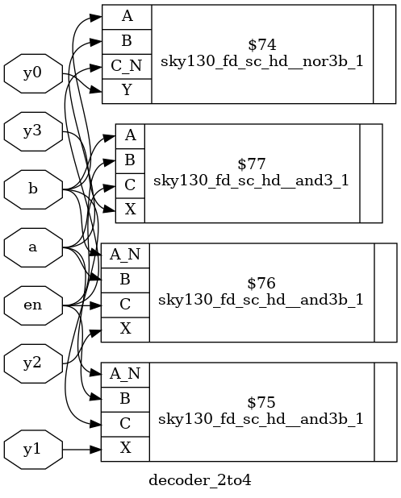

# Stage 01: RTL Simulation, Logic Synthesis & Gate-Level Verification
### Demonstration Circuit: 2-to-4 Line Binary Decoder with Active-High Enable


---

## 📌 Executive Summary
This stage covers the front-end ASIC verification and synthesis flow. A 2-to-4 line binary decoder with an active-high enable (`en`) switch is implemented in Verilog HDL, verified via behavioral simulation using Icarus Verilog and GTKWave, synthesized and mapped onto the **SkyWater 130nm High-Density (`sky130_fd_sc_hd`)** library via Yosys and ABC, and verified post-synthesis using **Gate-Level Simulation (GLS)**.

---

## 🔬 Circuit Architecture & Specifications

The decoder decodes a 2-bit binary input address (`a`, `b`) into one of four active-high output lines (`y0`, `y1`, `y2`, `y3`). When `en = 0`, all outputs are forced to `0` for low-power idle states.

### Truth Table:
| Enable (`en`) | Input `a` | Input `b` | `y0` | `y1` | `y2` | `y3` | Status / Active Line |
| :---: | :---: | :---: | :---: | :---: | :---: | :---: | :--- |
| `0` | `X` | `X` | `0` | `0` | `0` | `0` | Chip Disabled (Power Gate) |
| `1` | `0` | `0` | **`1`** | `0` | `0` | `0` | Line 0 Selected (`y0 = 1`) |
| `1` | `0` | `1` | `0` | **`1`** | `0` | `0` | Line 1 Selected (`y1 = 1`) |
| `1` | `1` | `0` | `0` | `0` | **`1`** | `0` | Line 2 Selected (`y2 = 1`) |
| `1` | `1` | `1` | `0` | `0` | `0` | **`1`** | Line 3 Selected (`y3 = 1`) |

### Boolean Logic Equations:
$$y0 = en \cdot \overline{a} \cdot \overline{b}$$
$$y1 = en \cdot \overline{a} \cdot b$$
$$y2 = en \cdot a \cdot \overline{b}$$
$$y3 = en \cdot a \cdot b$$

---

## 📊 Behavioral Simulation & Waveform Verification

The design was compiled using **Icarus Verilog (`iverilog`)** and verified in **GTKWave**.

### Compilation & Simulation Commands:
```bash
cd sim
iverilog -o decoder_sim.vvp ../rtl/decoder_2to4.v ../tb/decoder_2to4_tb.v
vvp decoder_sim.vvp
gtkwave decoder_2to4.vcd &
```

---

## ⚙️ Logic Synthesis & Silicon Technology Mapping

Synthesis was executed using **Yosys** and technology mapping was performed with **Berkeley ABC** targeting the typical-typical (TT) corner of the SkyWater 130nm library (`sky130_fd_sc_hd__tt_025C_1v80.lib`).

### Synthesis Command:
```bash
cd synth
yosys synth.ys
```

### Silicon Characterization:
* **Target Technology**: SkyWater 130nm CMOS
* **Standard Cell Library**: `sky130_fd_sc_hd`
* **Total Cell Count**: **4 physical cells**
* **Total Silicon Area**: **31.28 µm²**

```text
=== decoder_2to4 Cell Statistics ===
   sky130_fd_sc_hd__and3_1      : 1
   sky130_fd_sc_hd__and3b_1     : 2
   sky130_fd_sc_hd__nor3b_1     : 1
```

### Engineering Analysis of Synthesis Results:
1. **Inverter Elimination**: Standard cells with integrated inverting inputs (`A_N`, `C_N`) such as `and3b_1` and `nor3b_1` were selected by ABC, completely eliminating standalone inverter gates and reducing cell count from 8 to 4.
2. **De Morgan's Optimization**: Output `y0` was mapped to a `nor3b_1` cell because CMOS NOR structures exhibit smaller transistor sizing and lower propagation delays compared to discrete AND-NOT combinations.

### Silicon Gate-Level Schematic:


---

## 🔍 Gate-Level Simulation (GLS)

Post-synthesis verification ensures that logic synthesis and technology mapping preserved functional equivalence:

```bash
cd sim
iverilog -DFUNCTIONAL -DUNIT_DELAY=#1 -o decoder_gls.vvp \
  /home/srijanya/.volare/volare/sky130/versions/0fe599b2afb6708d281543108caf8310912f54af/sky130A/libs.ref/sky130_fd_sc_hd/verilog/primitives.v \
  /home/srijanya/.volare/volare/sky130/versions/0fe599b2afb6708d281543108caf8310912f54af/sky130A/libs.ref/sky130_fd_sc_hd/verilog/sky130_fd_sc_hd.v \
  ../synth/decoder_2to4_synth.v \
  ../tb/decoder_2to4_tb.v

vvp decoder_gls.vvp
```
**Result**: The post-synthesis gate netlist matched RTL behavioral waveforms with zero functional discrepancies.

---

## 📂 Stage 01 Directory Structure
```
01_rtl_simulation_and_synthesis/
├── rtl/
│   └── decoder_2to4.v         # Behavioral RTL Verilog
├── tb/
│   └── decoder_2to4_tb.v      # Testbench
├── sim/                       # Simulation directory
├── synth/
│   ├── synth.ys               # Yosys synthesis script
│   └── decoder_2to4_synth.v   # Sky130 Gate-level Netlist
├── docs/
│   └── images/                # Schematics & Waveforms
└── README.md
```
