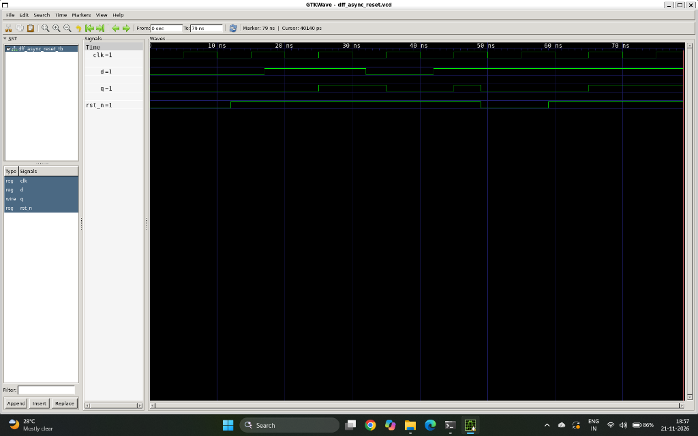
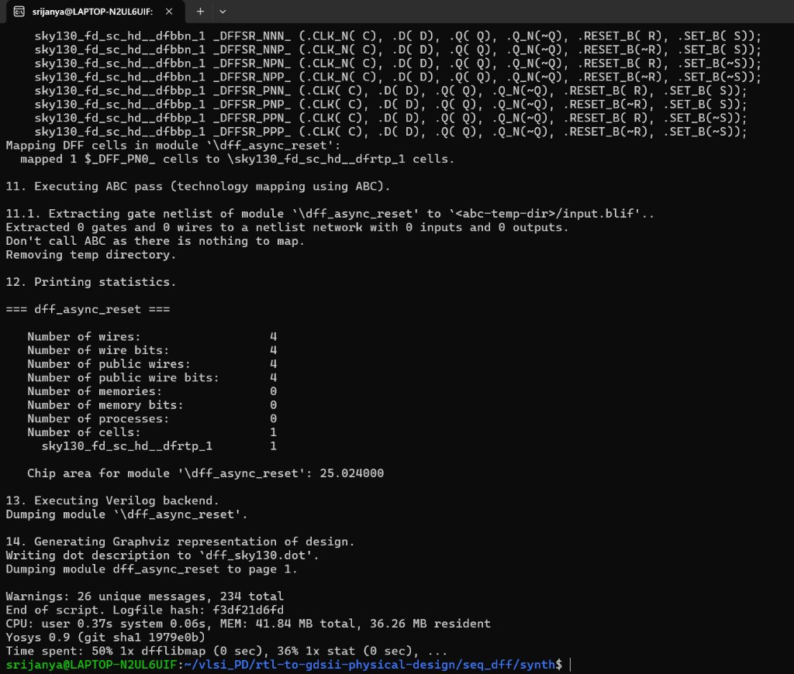
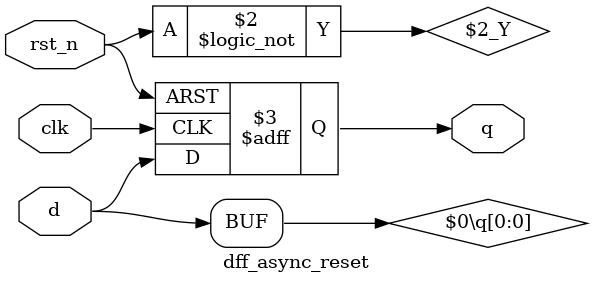
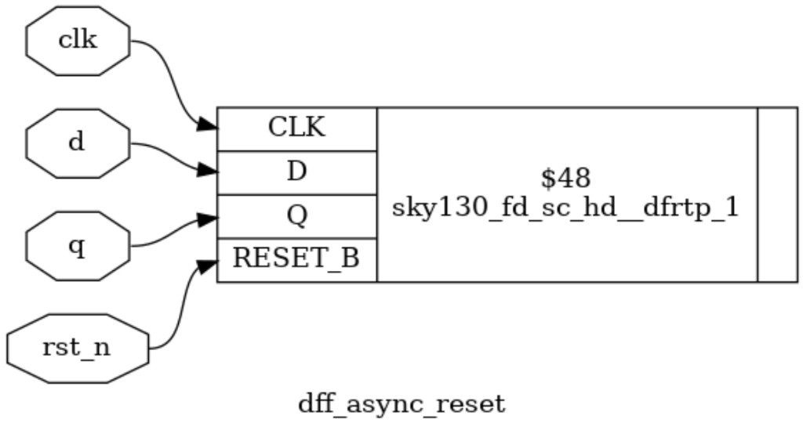
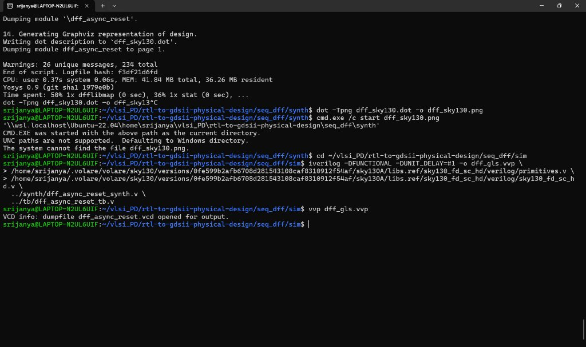

# Stage 02: Sequential Logic, Clocking & Gate-Level Verification
### Demonstration Circuit: D Flip-Flop with Active-Low Asynchronous Reset


---

## 📌 Executive Summary
This stage transitions the ASIC physical design journey from memoryless combinational logic to **sequential digital storage**. A Positive-Edge Triggered D Flip-Flop with an Active-Low Asynchronous Reset (`rst_n`) was modeled in Verilog HDL, verified via behavioral simulation in Icarus Verilog and GTKWave, synthesized onto dedicated sequential standard cells from the **SkyWater 130nm High-Density (`sky130_fd_sc_hd`)** library via Yosys `dfflibmap`, and verified post-synthesis using **Gate-Level Simulation (GLS)**.

---

## 🔬 Circuit Architecture & Operational Principle

The D Flip-Flop acts as the fundamental 1-bit storage unit across digital processors. Unlike combinational gates, the output $Q$ only samples input $D$ on the **rising edge of the clock** (`posedge clk`). An active-low asynchronous reset (`rst_n`) provides an immediate hardware override to force the register to 0 without waiting for a clock edge.

### Truth & Transition Table:
| Reset (`rst_n`) | Clock (`clk`) | Data Input (`d`) | Output ($Q_{next}$) | Operational State |
| :---: | :---: | :---: | :---: | :--- |
| **`0`** | Irrelevant | Irrelevant | **`0`** | **Asynchronous Reset (Forced Low)** |
| **`1`** | Rising Edge ($\uparrow$) | `0` | **`0`** | Clocked Latch (0 stored) |
| **`1`** | Rising Edge ($\uparrow$) | `1` | **`1`** | Clocked Latch (1 stored) |
| **`1`** | Steady (`0` or `1`) | Dynamic | **$Q_{prev}$** | Memory Retention (No clock pulse) |

---

## 📊 Behavioral Simulation & Waveform Verification

Simulation was executed using **Icarus Verilog (`iverilog`)** with a 10ns clock cycle (100 MHz clock frequency).

### Execution Commands:
```bash
cd sim
iverilog -o dff_sim.vvp ../rtl/dff_async_reset.v ../tb/dff_async_reset_tb.v
vvp dff_sim.vvp
gtkwave dff_async_reset.vcd &
```

### Behavioral Simulation Waveform:


#### Waveform Transition Analysis:
* **0 to 10 ns (`rst_n = 0`)**: Asynchronous reset is active. Output `q` remains clamped at `0`.
* **10 ns (`rst_n = 1`)**: Reset is de-asserted, placing the flip-flop into active operational mode.
* **20 to 30 ns (`d` transitions to `1`)**: Input `d` transitions high at 20ns, but output `q` waits until the **rising clock edge at 25ns** before latching to `1`.
* **30 to 40 ns (`d` transitions to `0`)**: Input `d` drops to 0 at 30ns, and `q` successfully latches to `0` on the **rising clock edge at 35ns**.
* **40 to 50 ns (`d` transitions to `1`)**: `q` latches back to `1` on the **rising edge at 45ns**.
* **50 to 60 ns (Asynchronous Reset Pulse)**: At 50ns, `rst_n` drops to `0`. Notice `q` drops to `0` **immediately** without waiting for the next clock pulse, proving asynchronous reset functionality.

---

## ⚙️ Logic Synthesis & Sequential Technology Mapping

Sequential synthesis requires mapping behavioral processes to foundry register cells using Yosys's `dfflibmap` and ABC targeting `sky130_fd_sc_hd__tt_025C_1v80.lib`.

### Synthesis Command:
```bash
cd synth
yosys synth.ys
```

### Yosys Synthesis Execution & Statistics Output:


### Silicon Characterization:
* **Target Technology**: SkyWater 130nm CMOS
* **Standard Cell Library**: `sky130_fd_sc_hd`
* **Mapped Sequential Cell**: **`sky130_fd_sc_hd__dfrtp_1`**
* **Total Cell Count**: **1 physical cell**
* **Total Silicon Area**: **25.024 µm²**

---

## 📐 Schematic Evolution: Pre-Synthesis vs Post-Synthesis

Demonstrating the transformation from abstract behavioral RTL to physical silicon standard cells:

### 1. Pre-Synthesis Generic Block Diagram (RTL Elaboration):
Shows the abstract `$adff` (Asynchronous D-FF) cell before technology mapping:


### 2. Post-Synthesis SkyWater 130nm Silicon Schematic:
Shows the physical `sky130_fd_sc_hd__dfrtp_1` standard cell with foundry pin names (`RESET_B`, `CLK`, `D`, `Q`):


---

## 🔍 Gate-Level Simulation (GLS)

Post-synthesis verification validates the mapped gate netlist against official SkyWater 130nm transistor behavioral models (`primitives.v` and `sky130_fd_sc_hd.v`):

```bash
cd sim
iverilog -DFUNCTIONAL -DUNIT_DELAY=#1 -o dff_gls.vvp \
  /home/srijanya/.volare/volare/sky130/versions/0fe599b2afb6708d281543108caf8310912f54af/sky130A/libs.ref/sky130_fd_sc_hd/verilog/primitives.v \
  /home/srijanya/.volare/volare/sky130/versions/0fe599b2afb6708d281543108caf8310912f54af/sky130A/libs.ref/sky130_fd_sc_hd/verilog/sky130_fd_sc_hd.v \
  ../synth/dff_async_reset_synth.v \
  ../tb/dff_async_reset_tb.v

vvp dff_gls.vvp
```

### Gate-Level Simulation Terminal Execution:


**Result**: The gate-level netlist exhibited exact functional equivalence with zero timing anomalies or logic mismatches.

---

## 📂 Stage 02 Directory Structure
```
02_sequential_logic_dff/
├── rtl/
│   └── dff_async_reset.v         # Behavioral RTL Verilog
├── tb/
│   └── dff_async_reset_tb.v      # Self-contained Testbench
├── sim/                          # Simulation directory & GLS executables
├── synth/
│   ├── synth.ys                  # Yosys sequential synthesis script
│   └── dff_async_reset_synth.v   # Sky130 Gate-level Netlist
├── docs/
│   └── images/                   # Schematics & Waveforms
└── README.md
```
